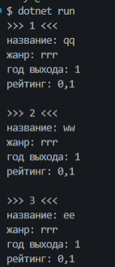

# GuildOfHeroes

Автор: Сташенко Дмитрий Николаевич
Дата выполнения: 27.10.26

## Собственный проект

Тема проекта: Каталог игр

Главный класс: Game

Почему этот объект нужен программе:
Класс Game описывает одну игру в каталоге. Без него пришлось бы хранить
название, жанр, год и рейтинг каждой игры в отдельных переменных, и при
добавлении новой игры код дублировался бы. Класс позволяет создавать
сколько угодно игр по одному шаблону.

Какие данные хранит объект:

- Name — название игры (string)
- Sh — жанр игры (string)
- age — год выхода (int)
- P — рейтинг игры (double)

Какие значения задаются через конструктор:
Только Name — название игры, потому что оно уникально и известно при создании.

Какие значения можно задавать автоматически:
Sh = "rrr", age = 1, P = 0.1 — эти значения задаются внутри конструктора
и не передаются снаружи, чтобы не загромождать вызов new Game().

---

## Дополнительное задание

Какое значение я решил задавать автоматически и почему?
Жанр (Sh), год выхода (age) и рейтинг (P) задаются автоматически внутри
конструктора, потому что при создании игры достаточно указать её название.
Остальные параметры можно изменить позже, а начальные значения нужны,
чтобы объект сразу был корректным и не содержал null/0 по умолчанию.

---

## Скриншоты

